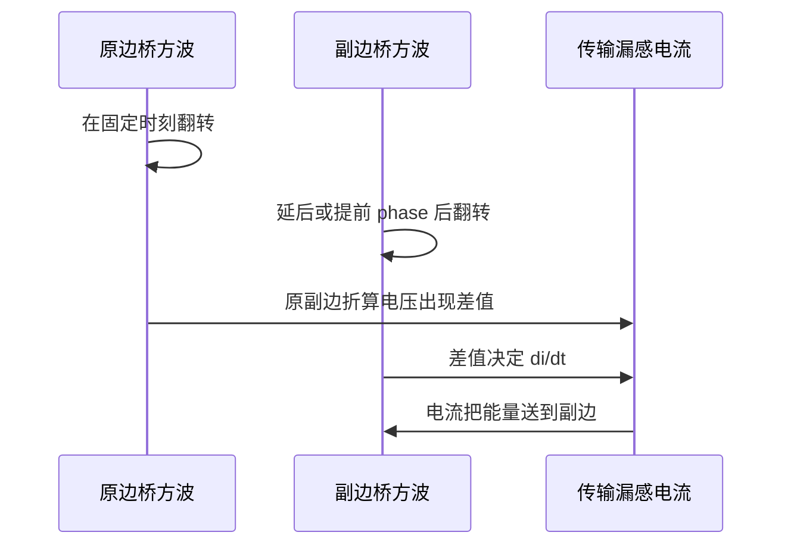
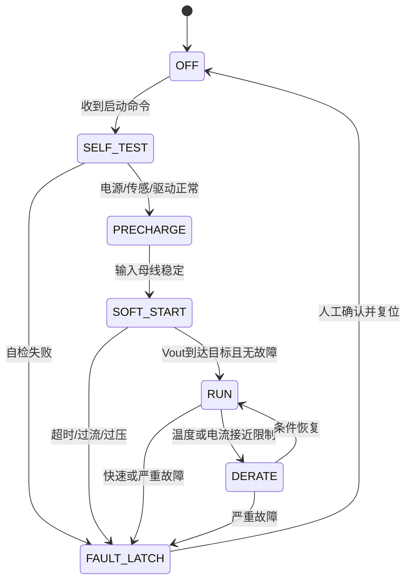

# DAB RA8P1 仿真、电路与 MCU 控制零基础全解

> 版本：2026-07-11 全面重写版
> 唯一对应模型：`DAB_RA8P1_Final_Physical_MOSFET.slx`
> MATLAB/Simulink：R2024b
> 默认保存工况：`Vin=24V`、`Vref=48V`、`Rload=23.04Ohm`、仿真时间 `10ms`
> 本文替换旧版同名文档。凡是旧文档、旧截图或旧 BOM 与本文冲突，以当前 `.slx`、新版 BOM 和本文为准。

---

## 0. 这份文档适合谁，以及应该怎么读

这份文档按“完全没有电力电子基础”来写。你不需要先懂 DAB、MOSFET、PWM、PI 或 Simscape。

建议分三遍阅读：

1. 第一遍只读第 1～7 章，先知道这个装置为什么能把 24V 变成接近 48V。
2. 第二遍读第 8～20 章，顺着电流经过的每一个硬件模块理解模型。
3. 第三遍读第 21～35 章，理解 MCU 怎么采样、计算相移、输出 8 路 PWM，并保护硬件。

如果只想先抓住结论，请记住下面六句话：

1. 这是一个 **DAB 双有源桥隔离 DC-DC 变换器**。
2. 原边和副边各有一个 MOSFET 全桥，共 8 只功率 MOSFET。
3. 变压器固定为 `Np:Ns=1:2`，不能通过改匝比“调漂亮”输出结果。
4. MCU 不主要改变占空比，而是改变两个全桥方波之间的 **相移**。
5. 输出滤波器用 `2.2uH + 8000uF + 44uF有效高频电容` 把脉动电流变成较平稳的直流电压。
6. 当前正式验证点是 `24V -> 接近48V / 100W`；保存模型后半段平均值约 `47.9834V`，纹波约 `0.06114Vpp`。

---

## 1. 先认识最基本的电学量

### 1.1 电压、电流、功率

- 电压 `V`：可以理解成推动电荷流动的“压力差”。
- 电流 `A`：单位时间内流过的电荷量。
- 功率 `W`：能量传递速度，直流条件下近似为：

```text
P = V x I
```

例如输出为 48V、100W：

```text
Iout = P / V = 100 / 48 = 2.083A
```

输出为 48V、500W：

```text
Iout = 500 / 48 = 10.417A
```

### 1.2 电阻、电感、电容分别做什么

**电阻 R** 会限制电流并消耗功率：

```text
V = I x R
P_loss = I^2 x R
```

**电感 L** 不喜欢电流突然改变：

```text
V_L = L x di/dt
```

电感两端有电压时，电流会按斜坡上升或下降。DAB 正是利用漏感让能量可控地传递。

**电容 C** 不喜欢电压突然改变：

```text
I_C = C x dv/dt
```

电容会在负载需要能量时放电，在变换器送来能量时充电，因此可以平滑输出电压。

### 1.3 为什么元件还有 ESR、DCR 和寄生参数

现实元件都不理想：

- 电感导线有电阻，叫 DCR。
- 电容内部有等效串联电阻，叫 ESR。
- MOSFET 导通后仍有 `Rds(on)`。
- 变压器绕组有铜阻、漏感和绕组间电容。
- PCB 走线和线缆也有电阻与电感。

本模型把其中很多非理想因素明确建了出来，所以它不是一个只用理想开关拼出来的示意模型。但它仍没有覆盖所有温升、磁芯损耗和 PCB 高频寄生，后面会说明边界。

### 1.4 常见单位换算

```text
1 kHz = 1,000 Hz
1 MHz = 1,000,000 Hz
1 ms  = 0.001 s
1 us  = 0.000001 s
1 ns  = 0.000000001 s
1 mOhm = 0.001 Ohm
1 uH  = 0.000001 H
1 uF  = 0.000001 F
1 nF  = 0.000000001 F
1 pF  = 0.000000000001 F
```

---

## 2. 整个系统是什么

这个模型是一台带高频隔离的升压型 DC-DC 电源。默认把 24V 直流电转换为接近 48V 的直流电。


能量流和控制流是两条不同的路径：

- 粗的功率路径负责传递几十到几百瓦能量。
- 细的采样与 PWM 路径只传递信息和控制命令。
- MCU 绝不能直接驱动功率 MOSFET，必须经过隔离栅极驱动器。

---

## 3. 为什么叫 DAB 双有源桥

`DAB` 是 `Dual Active Bridge` 的缩写，中文叫“双有源桥”。

### 3.1 “双”是什么意思

变压器两侧各有一个全桥：

- 原边桥：Q1、Q2、Q3、Q4。
- 副边桥：Q5、Q6、Q7、Q8。

### 3.2 “有源”是什么意思

普通二极管整流桥只能被动导通，而这里两侧都使用可控 MOSFET。副边也能主动按时序开关，因此：

- 可以做同步整流，降低二极管压降损耗。
- 理论上可以双向传输功率。
- 可以通过两桥相位关系调节功率。

当前项目只验证了从 24V 侧向 48V 侧传能，没有完成反向运行验证。

### 3.3 为什么不用普通 Boost

DAB 的优势是：

- 变压器提供原副边电气隔离。
- 通过匝比实现基础电压变换。
- 两侧都是全桥，适合中高功率和双向场景。
- 合理设计时有机会实现软开关，降低高频开关损耗。

代价是：

- 8 只 MOSFET 和 4 颗隔离驱动器，硬件复杂。
- 变压器、漏感、死区和相移需要联合设计。
- 控制和保护比普通 Buck/Boost 更复杂。
- 300kHz 下布局和寄生参数非常敏感。

本项目因此保留 MOSFET DAB 版本，不再保留复杂度更高但收益不明确的 GaN 版本。

---

## 4. 全桥怎样把直流变成高频方波

一个全桥由两个半桥组成。每个半桥有一只高侧管和一只低侧管。

原边桥对应关系：

| 桥臂 | 高侧 MOSFET | 低侧 MOSFET |
|---|---|---|
| A 桥臂 | Q1 | Q2 |
| B 桥臂 | Q3 | Q4 |

副边桥对应关系：

| 桥臂 | 高侧 MOSFET | 低侧 MOSFET |
|---|---|---|
| A 桥臂 | Q5 | Q6 |
| B 桥臂 | Q7 | Q8 |

每个半桥内部高、低侧互补开关。A、B 两个桥臂相差半个周期。因此变压器绕组两端会交替看到正电压和负电压。

以原边 24V 母线为例：

- Q1 与 Q4 导通，可在原边绕组施加约 `+24V`。
- Q2 与 Q3 导通，可在原边绕组施加约 `-24V`。
- 两种状态每个开关周期交替一次，形成 300kHz 双极性方波。

MOSFET 实际导通压降、绕组电阻和线缆阻抗会使绕组电压略低于理想值。

---

## 5. 300kHz、周期和死区是什么

当前开关频率：

```text
fs = 300kHz
Tsw = 1 / fs = 3.333us
```

一个周期中，每个半桥的高侧和低侧理论上各占约 50%。但不能让上下管在交接瞬间同时导通，否则会把直流母线直接短路，这叫“桥臂直通”。

所以控制器加入：

```text
dead time = 120ns
```

模型的单个半桥逻辑为：

```text
高侧导通：120ns 到 Tsw/2 - 120ns
低侧导通：Tsw/2 + 120ns 到 Tsw - 120ns
其余短时间：高低侧都关闭
```

120ns 不是越大越安全：

- 太短可能直通。
- 太长会让体二极管导通时间增加，造成损耗和波形畸变。
- 实板必须结合驱动传播延迟、MOSFET 关断速度、温度和示波器实测调整。

模型还在隔离驱动接口中增加了 `45ns` 传输延迟。因为两路使用相同延迟，主要体现整体延后；实物中更危险的是通道间延迟不匹配，需要在死区预算中留余量。

---

## 6. 变压器为什么能把 24V 变成约 48V

当前变压器固定为：

```text
Np:Ns = 1:2
```

理想情况下，副边方波幅值约为原边的两倍：

```text
Vs / Vp = Ns / Np = 2
24V x 2 = 48V
```

模型用互感器件表示变压器：

| 参数 | 当前值 | 含义 |
|---|---:|---|
| 原边励磁电感 L1 | 57.5uH | 原边看到的励磁电感 |
| 副边励磁电感 L2 | 230uH | 副边看到的励磁电感 |
| 耦合系数 k | 0.999999 | 非常接近理想耦合 |
| 副边折算传输漏感 | 0.5uH | 控制传输电流斜率的关键电感 |
| 原边 DCR | 0.95mOhm | 原边绕组铜阻 |
| 副边 DCR | 3.0mOhm | 副边绕组铜阻 |

因为：

```text
sqrt(L2 / L1) = sqrt(230 / 57.5) = 2
```

所以模型的电感比严格对应 1:2 匝比。

必须理解：**1:2 只给出基础电压比例，不等于负载下输出永远精确为 48.000V。** 真实系统还会受到绕组铜阻、MOSFET 压降、漏感、电感 DCR、控制相移和负载影响。

---

## 7. DAB 真正调功率的关键：相移

原边桥和副边桥都生成 300kHz、约 50% 占空比的方波。MCU 改变的是副边方波相对原边方波的时间偏移 `phase`。



### 7.1 为什么相移会产生电流

把副边电压按匝比折算到原边后，漏感两端电压近似为：

```text
V_Llk = V_primary - V_secondary_referred
di/dt = V_Llk / Llk
```

当两个桥完全同相且折算电压相等时，漏感两端平均差分电压很小，传输功率也小。

当两桥错开一段时间时，某些区间原边和副边折算电压方向不同，漏感两端出现较大电压，电流按斜坡变化，于是产生净功率传输。

### 7.2 常见近似功率公式

单移相 DAB 的理想近似式常写成：

```text
P ≈ (n x V1 x V2 / (omega x Llk)) x phi x (1 - |phi|/pi)
```

其中：

- `n` 是统一折算方向后的匝比系数。
- `omega = 2 x pi x fs`。
- `phi` 是弧度形式相移。
- `Llk` 是统一折算侧的传输电感。

这个公式用于建立直觉，不应直接拿来替代当前仿真，因为当前模型还有导通压降、死区、寄生电容、滤波器和经验前馈。

### 7.3 当前额定点的相移

最新保存模型在 `24V/48V/100W` 仿真末尾：

```text
phase ≈ +0.255us
相移占周期 ≈ 0.255 / 3.333 = 7.65%
对应电角度 ≈ 27.5度
```

在当前模型的符号约定中，这个正相移对应从 24V 侧向 48V 侧传输功率。

---

## 8. 一个开关周期内，能量怎样走

为了建立直觉，可以把一个周期简化成四段。实际边界会因相移和死区改变。

### 阶段 A：两个桥电压方向一致

原边和副边折算电压方向相同，漏感两端电压较小，电流维持或缓慢变化。

### 阶段 B：原边已经换向，副边尚未换向

漏感两端出现明显电压差，漏感电流快速按斜坡变化。这一段是相移产生功率传输的核心区间。

### 阶段 C：两个桥再次同向

漏感电流继续流向副边，副边 MOSFET 以同步整流方式把高频交流能量送入副边直流母线。

### 阶段 D：副边先后完成下一次换向

漏感电流反向斜坡，完成一个对称周期。

由于电感电流不能瞬间突变，死区期间它会通过 MOSFET 输出电容或体二极管续流。这可能帮助实现零电压开通，也可能增加二极管损耗。当前模型包含 MOSFET 电容和体二极管，但没有把“所有工况都实现 ZVS”作为已验证结论。

---

## 9. 从输入端开始看硬件：电源与源阻抗

模型的 `Input_EMI_DC_Link` 子系统是整个电源的入口。

### 9.1 输入电压源

保存模型参数：

```text
dc_voltage = 24V
标注工作范围 = 18V～32V
```

24V 是当前正式额定验证点。18V 和 32V 只做过应力矩阵，不代表全范围都已经闭环调好。

### 9.2 台式电源与线缆等效

模型在理想电压源后串入：

| 元件 | 参数 | 作用 |
|---|---:|---|
| 电源输出等效电阻 | 30mOhm | 模拟台式电源、线束和接插件压降 |
| 线缆等效电感 | 0.2uH | 模拟高频电流变化引起的线缆电感 |
| 线缆电感串联电阻 | 3mOhm | 模拟线缆铜阻 |
| 输入分流器 | 1mOhm | 测量输入电流 |

例如输入电流 25A 时，仅 30mOhm 就产生：

```text
Vdrop = 25A x 0.03Ohm = 0.75V
Ploss = 25^2 x 0.03 = 18.75W
```

这说明 500W 工况下输入线束和电源内阻不能忽略。

---

## 10. 输入共模扼流圈为什么是真共模，而输出旧电感为什么被删除

输入端使用一个真正的双绕组耦合共模扼流圈：

| 参数 | 当前值 |
|---|---:|
| 每绕组电感 | 2mH |
| 耦合系数 | 0.9997 |
| 每绕组 DCR | 3.5mOhm |
| 额定电流目标 | 30A |
| 绕组间寄生电容 | 20pF |

正常差模电流从正线流入、从负线流回，两绕组磁通大体抵消，所以它不会像两只独立 2mH 电感那样严重阻碍直流功率。

共模噪声在两根线上同向流动，两绕组磁通相加，因此共模阻抗很高，可以抑制噪声。

旧输出模型曾在正、负线上各串一个互不耦合的 2.2uH 电感。它们没有共模磁通抵消，反而给差模功率回路额外增加 4.4uH，引入压降和谐振。因此当前模型已把它们删除。

如果实板输出端需要共模滤波，必须使用真正的双绕组耦合器件并建立耦合模型，不能恢复两只独立电感。

---

## 11. 输入电容网络分别处理什么频率

输入端不是只放一颗大电容，而是多层次组合：

| 支路 | 模型参数 | 主要作用 |
|---|---:|---|
| 输入大电解 | 4000uF，ESR 6mOhm | 提供低频和大能量缓冲 |
| 高频电容组 | 220uF，ESR 1mOhm | 给桥臂高频脉冲电流提供近端回路 |
| 差模薄膜电容 | 2.2uF，ESR 10mOhm | 抑制更高频差模噪声 |
| 阻尼支路 | 0.33Ohm 串 110uF | 给输入 LC 网络增加阻尼 |
| 两只 Y 电容 | 各 2.2nF | 把共模高频电流引到 PE/机壳参考 |
| 泄放电阻 | 100kOhm | 断电后释放电容电荷 |

物理 BOM 中输入高频组对应 10 只 `22uF/100V/X7R`。模型按 220uF 名义值使用，因此实板还应根据厂家直流偏压曲线复核 24V 下的有效容量。

Y 电容只有在系统存在定义明确的保护地或机壳参考时才有意义。若设备是完全浮地结构，不能随意把原副边地或所谓 PE 接在一起；Y 电容的安规等级、漏电流和隔离距离必须单独审核。

---

## 12. 原边 MOSFET 全桥怎样建模

原边子系统名为 `PRI_Full_Bridge_RealDrivers`，内部有两个桥臂，每个桥臂包含：

- 一只高侧 N 沟道 MOSFET。
- 一只低侧 N 沟道 MOSFET。
- 独立栅极等效网络。
- 独立 D-S RC 吸收网络。

最终 8 只功率管统一选用 `AONS66917`，模型主要参数为：

| 参数 | 当前值 | 影响 |
|---|---:|---|
| Vds 额定值 | 100V | 允许的漏源电压上限，实板必须留尖峰余量 |
| Rds(on)，25C | 2.9mOhm | 导通损耗 |
| 高温等效 Rds(on) | 4.8mOhm | 模拟温升后电阻上升 |
| Vth | 2.2V | 开始形成沟道的阈值，不是推荐驱动电压 |
| Ciss | 5940pF | 驱动器需要充放的输入电容 |
| Crss | 24pF | 米勒耦合的重要参数 |
| Coss | 1475pF | 换流和软开关的重要参数 |
| Qg 选型依据 | 80nC | 估算栅极驱动功率 |

`Vth=2.2V` 不代表用 2.2V 就能可靠开通。模型使用约 +10V 开通、-2V 关断的等效栅压。

MOSFET 导通损耗粗略为：

```text
Pcond ≈ Irms^2 x Rds(on)
```

但 300kHz 下还必须考虑开关损耗、Coss 换流、体二极管、栅极驱动和死区损耗，不能只按 Rds(on) 选管。

---

## 13. 隔离栅极驱动链路

### 13.1 为什么 MCU 不能直接接 MOSFET 栅极

MCU GPIO 电压和电流都不足，而且高侧 MOSFET 的源极会随开关节点高速跳动。直接连接既无法正确驱动，也会破坏隔离并可能损坏 MCU。

当前硬件方案每个半桥使用一颗双通道隔离驱动器：

```text
4个半桥 x 1颗 UCC21520DWR = 4颗驱动器
```

每颗分别驱动同一桥臂的高侧和低侧。

### 13.2 模型里的隔离接口

`Isolated_Gate_Drive_Interface` 将 8 路 PWM 分成四组：

| 驱动器组 | 输入 | 输出到 |
|---|---|---|
| U1_Primary_A | PWM1、PWM2 | Q1、Q2 |
| U2_Primary_B | PWM3、PWM4 | Q3、Q4 |
| U3_Secondary_A | PWM5、PWM6 | Q5、Q6 |
| U4_Secondary_B | PWM7、PWM8 | Q7、Q8 |

每路包含：

- 45ns 传输延迟。
- 0～10 的逻辑幅度钳位。
- 后续栅极等效电路把 0/10 命令变成约 -2V/+10V 栅压。

### 13.3 每只 MOSFET 的栅极等效电路

| 元件 | 当前值 | 作用 |
|---|---:|---|
| 开通电阻 Rg_on | 4.7Ohm | 限制开通栅电流和 dv/dt |
| 关断电阻 Rg_off | 1.2Ohm | 加快关断，降低直通风险 |
| 快关二极管 | 单向旁路 | 让开通、关断使用不同电阻 |
| 栅源下拉 | 100kOhm | 驱动掉电时保持关闭 |
| 模型关断偏置 | -2V | 抵抗米勒误导通 |
| D-S 吸收电阻 | 6.8Ohm | RC 吸收阻尼 |
| D-S 吸收电容 | 1nF | 吸收尖峰与振铃能量 |

模型中的 1nF/6.8Ohm 是统一初值，不是实板最终答案。实板应先测 Vds 振铃频率和寄生参数，再调整吸收器；电阻功率必须用示波器波形估算。

### 13.4 隔离驱动电源

当前 BOM 使用 `NMK0512SAC` 作为每个半桥的 5V 到 12V、2W 隔离电源，并配合自举支路给高侧供电。

按每只 MOSFET `Qg=80nC` 粗估一个半桥两只管的纯栅极充放电功率：

```text
Pgate = 2 x Qg x Vgate x fs
      = 2 x 80nC x 12V x 300kHz
      = 0.576W
```

这还没包括驱动器自身消耗和转换损耗，所以 2W 模块比 1W 更有余量。非稳压隔离模块的空载电压可能偏高，实际必须加去耦和栅压钳位，并测量各工况输出。

---

## 14. 高频变压器的非理想参数

模型中的 `T1_HF_Transformer_Real` 不只有理想匝比，还包括：

| 元件 | 参数 |
|---|---:|
| 原边绕组电阻 | 0.95mOhm |
| 副边绕组电阻 | 3.0mOhm |
| 副边折算传输漏感 | 0.5uH，串联电阻 0.1mOhm |
| 原边绕组电容 | 220pF，ESR 0.05Ohm |
| 副边绕组电容 | 150pF，ESR 0.05Ohm |
| 原副边绕组间电容 | 100pF，ESR 0.1Ohm |

这些参数分别影响：

- 绕组电阻：造成铜损和电压下降。
- 漏感：决定 DAB 电流斜率和传输功率。
- 绕组电容：与漏感、MOSFET Coss 形成高频振铃。
- 绕组间电容：给共模电流提供原副边耦合路径，影响 EMI。

模型没有完整的频率相关磁芯损耗、趋肤效应和邻近效应，所以不能仅凭当前效率计算判断 PQ4040 温升安全。

变压器实物设计仍需完成：

1. 核心材料 PC95 在 300kHz 下的损耗计算。
2. 最大磁通密度与伏秒平衡检查。
3. 绕组层数、铜箔或利兹线选择。
4. 原副边爬电距离、绝缘胶带和耐压测试。
5. 实测励磁电感、漏感、DCR 和温升回填模型。

---

## 15. 副边有源桥怎样完成同步整流

副边全桥结构与原边相同，也是两组半桥、4 只 AONS66917。

它的两个作用是：

1. 按相移产生需要的副边方波，使漏感获得可控差分电压。
2. 把变压器送来的高频交流能量同步整流到副边直流母线。

同步整流不是让 MOSFET 永远取代体二极管。死区期间，电感电流仍可能先流过体二极管或给 Coss 充放电，然后 MOSFET 再开通。

副边与原边在 Simscape 中使用独立电气参考，没有把两侧“地”直接短接。隔离只通过变压器磁耦合和明确建模的绕组间电容发生。

---

## 16. 输出滤波器从高频脉动变成直流

副边全桥之后的 `Output_Filter_Load` 是本轮电路优化重点。

### 16.1 当前拓扑

```text
副边桥直流母线
  -> 47uF/80V CSEC
  -> 2.2uH 输出功率电感
  -> 输出电流传感器
  -> 8000uF 电解电容组
  -> 44uF 有效高频 MLCC
  -> 负载
```

### 16.2 副边母线电容 CSEC

```text
CSEC = 47uF
ESR = 36mOhm
```

它位于输出电感之前，主要承接副边全桥的高频换流电流，减小开关脉动直接传播到后级。

### 16.3 输出功率电感

最终选择 `MTP2920-2R2MC` 对应模型：

```text
Lout = 2.2uH
DCR = 2.5mOhm
额定电流 = 30A
饱和电流 = 100A
```

它限制流向输出电容的高频电流变化。电感太小会增加纹波，太大会减慢动态并与电容形成更低频谐振。

### 16.4 输出大电解电容组

模型值：

```text
Cout_bulk = 8000uF
ESR = 3.875mOhm
```

物理方案是 8 只 `1000uF/80V` 并联：

```text
Ceq = 8 x 1000uF = 8000uF
ESReq = 31mOhm / 8 = 3.875mOhm
总纹波电流额定值 = 8 x 3.4A = 27.2A @ 100kHz
```

并联电容必须尽量等长、对称连接，否则最靠近功率回路的几只会承担更多纹波电流。

### 16.5 高频 MLCC 支路

物理 BOM 是 5 只 `22uF/100V/X7R`，名义总容量 110uF。

X7R 在 48V 直流偏压下会损失容量。当前缺少完整偏压曲线，因此模型保守采用：

```text
有效容量 = 44uF
等效 ESR = 2mOhm
```

这是有意让模型更接近实物，而不是为了让波形更漂亮。

### 16.6 输出其他支路

| 元件 | 当前值 | 作用 |
|---|---:|---|
| 输出泄放电阻 | 100kOhm | 断电后放电 |
| 输出 Y 电容 | 正、负各 2.2nF | 条件安装的共模 EMI 支路 |
| PE 泄放等效 | 100MOhm | 给浮置节点提供数值参考 |
| 默认负载 | 23.04Ohm | 对应 48V/100W |

输出端已没有两只旧的独立 2.2uH “伪共模”电感。

---

## 17. 负载电阻为什么是 23.04Ohm

阻性负载功率：

```text
P = V^2 / R
```

目标 48V、100W：

```text
R = V^2 / P = 48^2 / 100 = 23.04Ohm
```

目标 48V、500W 时，应力脚本临时设置：

```text
R = 48^2 / 500 = 4.608Ohm
```

脚本运行结束后关闭模型而不保存，所以默认模型仍是 23.04Ohm。500W 结果属于短时应力验证，不等于热稳态通过。

---

## 18. 为什么输出仍然有纹波

输出纹波主要来自：

1. 副边桥以 300kHz 开关，送入输出网络的电流不是完美直流。
2. 输出电感电流有周期性三角波。
3. 电解电容 ESR 会把纹波电流直接转换成纹波电压。
4. 相移控制每 10us 更新一次，会产生较低频的调制成分。
5. 输出 LC 网络和阻尼共同决定低频包络。
6. MOSFET、漏感和寄生电容会产生高频振铃。

粗略可分成两部分：

```text
电容充放电纹波约为 DeltaI / (C x f)
ESR纹波约为 DeltaI x ESR
```

增加电容不一定无限有效：当 ESR、PCB 电感或控制环路成为主导后，继续堆电容收益会变小，还会增加启动浪涌和体积。

---

## 19. 当前采样链路在模型中怎么表示

模型测量：

- `Vin`：输入 DC-Link 电压。
- `Iin`：输入分流器电流。
- `Vout`：最终负载端电压。
- `Iout`：输出负载电流。

Simscape 电压/电流传感器先输出物理信号，再通过 `PS-Simulink Converter` 转换为 Simulink 数值。

控制器前还放了三个 Unit Delay：

| 信号 | 延迟采样时间 | 初值 |
|---|---:|---:|
| Vout | 1us | 0V |
| Vin | 1us | 24V |
| Iout | 1us | 0A |

这表示控制器看到的是约 1us 之前的采样值，用来近似 ADC 采样与传输延迟。

注意：模型中的传感器没有完整加入量化噪声、零点偏差、增益误差、温漂、共模瞬态干扰和 ADC 参考误差。因此仿真中的毫伏级均值不能直接等同于实板毫伏级准确度。

---

## 20. 实物采样硬件如何对应

### 20.1 输入电流

```text
Rshunt_in = 1mOhm
隔离放大器 = AMC3302
增益约 = 41
```

理想换算：

```text
Iin = Vdiff_out / (41 x 0.001)
```

50A 时分流电压为 50mV，正好接近 AMC3302 的输入量程边缘。PCB 必须使用 Kelvin 四线连接。

### 20.2 输出电流

输出用两只 1mOhm 串联：

```text
Rshunt_out = 2mOhm
Iout = Vdiff_out / (41 x 0.002)
```

500W 时约 10.42A，分流电压约 20.8mV，隔离放大器差分输出约 0.853V。

### 20.3 输入电压

输入分压：

```text
上臂 = 2 x 100kOhm
下臂 = 6.34kOhm
AMC3330增益约 = 2
```

理想换算：

```text
Vin = (Vdiff_out / 2) x (200k + 6.34k) / 6.34k
```

32V 时，放大器输入约 0.984V，差分输出约 1.968V。

### 20.4 输出电压

输出分压：

```text
上臂 = 2 x 100kOhm
下臂 = 3.24kOhm
AMC3330增益约 = 2
```

理想换算：

```text
Vout = (Vdiff_out / 2) x (200k + 3.24k) / 3.24k
```

60V 时，放大器输入约 0.956V，差分输出约 1.913V。

### 20.5 为什么实板不可能只靠 0.1% 电阻达到 1mV

1mV 相对于 48V 是：

```text
1mV / 48V = 20.8ppm
```

而 0.1% 电阻单项误差就是 1000ppm，尚未计入放大器、ADC、参考源和温漂。因此实板若要逼近毫伏级平均精度，必须：

1. 使用精密匹配电阻网络。
2. 使用稳定参考源和合适 ADC 采样时间。
3. 做零点、增益和温度标定。
4. 在目标输出端用高精度仪表闭环校准。
5. 把校准系数存入非易失存储器并带 CRC。

当前仿真目标是验证拓扑、控制趋势和纹波，不是证明实板已经达到 1mV 计量精度。

---

## 21. Simulink 顶层结构逐块解释

当前顶层主要模块如下：

| 顶层模块 | 作用 |
|---|---|
| `Input_EMI_DC_Link` | 输入源、源阻抗、共模扼流圈、电容和 Vin/Iin 传感 |
| `PRI_Full_Bridge_RealDrivers` | 原边 4 只 MOSFET 与栅极等效网络 |
| `T1_HF_Transformer_Real` | 1:2 变压器、铜阻、漏感和寄生电容 |
| `SEC_Full_Bridge_RealDrivers` | 副边 4 只 MOSFET 与栅极等效网络 |
| `Output_Filter_Load` | 副边母线电容、输出电感、电容组、负载和传感 |
| `RA8P1_Realtime_Voltage_PI` | 采样滤波、前馈、误差修正和 8 路 PWM 生成 |
| `Isolated_Gate_Drive_Interface` | 四组隔离驱动延迟与逻辑钳位 |
| `Power_Efficiency_Calc` | 计算瞬时 Pin、Pout 和显示用效率 |
| Scope / To Workspace | 显示和导出仿真波形 |

顶层 Goto/From 块只是减少长连线，信号本身没有被改变。

---

## 22. Simscape 和普通 Simulink 信号有什么不同

模型中有三类连接：

1. **Simscape 物理端口**：绿色/物理网络连接，电流和电压由电路方程共同求解，没有固定“输入到输出”方向。
2. **Simulink 信号**：有明确箭头，传递数值，例如 PWM、Vout 数字量。
3. **PS 转换信号**：在 Simscape 和 Simulink 之间转换。

例如 Vout 测量路径：

```text
物理输出节点
 -> Voltage Sensor
 -> PS-Simulink Converter
 -> Goto/From
 -> 1us Unit Delay
 -> MCU控制函数
```

PWM 路径则相反：

```text
MCU控制函数输出0/10
 -> 隔离驱动延迟
 -> 栅极等效电路
 -> Controlled Voltage Source
 -> MOSFET G-S物理端口
```

---

## 23. 仿真求解器为什么设置得很细

当前模型配置：

| 参数 | 当前值 |
|---|---:|
| Solver | `daessc` |
| 类型 | Variable-step |
| 最大步长 | 50ns |
| 相对误差 | 2e-3 |
| 绝对误差 | 1e-5 |
| 停止时间 | 10ms |

300kHz 周期是 3.333us，50ns 最大步长意味着一个周期最多约有：

```text
3.333us / 50ns ≈ 66.7个步长
```

这样才能分辨 120ns 死区、45ns 驱动延迟和开关瞬态。

`daessc` 适合含有 Simscape 电气网络的微分代数方程。变量步长会在平缓区增大步长、在开关瞬间缩小步长。

不能为了加速随意把最大步长改成 1us，因为那几乎会跳过死区和许多换流细节，得到看似平滑但不可信的波形。

---

## 24. 控制器到底输入什么、输出什么

`RA8P1_Realtime_Voltage_PI` 输入：

| 输入 | 含义 |
|---|---|
| `t` | 当前仿真时间 |
| `Vout` | 延迟后的输出电压 |
| `VrefCmd` | 输出设定值，默认 48V |
| `Vin` | 延迟后的输入电压 |
| `Iout` | 延迟后的输出电流 |

输出：

| 输出 | 对应器件 |
|---|---|
| `g1/g2` | Q1/Q2 原边 A 桥臂 |
| `g3/g4` | Q3/Q4 原边 B 桥臂 |
| `g5/g6` | Q5/Q6 副边 A 桥臂 |
| `g7/g8` | Q7/Q8 副边 B 桥臂 |
| `PhaseUs` | 当前相移，单位 us，用于记录 |

输出门极命令为 0 或 10。后级等效驱动器再把它转换成实际栅压。

---

## 25. 控制器的时间尺度

控制器内部有两个时间尺度：

```text
开关周期 Tsw = 3.333us
控制周期 TsCtrl = 10us
```

也就是说：

- PWM 硬件每 3.333us 重复一次。
- 电压控制算法每 10us 更新一次，大约每 3 个开关周期更新相移。

MCU 不应该每个 CPU 指令手工翻转 8 个 GPIO。正确方法是：

- GPT 定时器持续产生互补 PWM。
- CPU 每 10us 只计算新的相移计数。
- 新比较值写入缓冲寄存器，在统一周期边界生效。

---

## 26. 控制器初始化时保存哪些状态

MATLAB Function 使用持久变量：

| 变量 | 初值 | 作用 |
|---|---:|---|
| `trim` | 0 | 闭环小修正量 |
| `prevErr` | 0 | 上一周期电压误差 |
| `lastTick` | -1 | 判断是否进入新的 10us 控制周期 |
| `vFilt` | 0 | 滤波后的 Vout |
| `vinFilt` | 24 | 滤波后的 Vin |
| `iFilt` | 0 | 滤波后的 Iout 绝对值 |

第一次执行时，滤波器直接装载当前测量值，避免从 0 慢慢爬升造成巨大虚假误差。

---

## 27. 设定值和采样限幅

输出设定被限制为：

```text
Vref = clamp(VrefCmd, 36V, 48V)
```

输入采样用于前馈前被限制为：

```text
Vin_used = clamp(Vin, 18V, 32V)
```

限幅的目的不是把错误测量变正确，而是防止异常值让经验公式计算出极端相移。

真正的软件还应先做传感器合理性判断。例如 ADC 断线、饱和或超范围时，应进入故障状态，而不是只依靠 clamp 继续运行。

---

## 28. 三个数字低通滤波器

每 10us 更新一次：

```c
vFilt   = vFilt   + 0.40f * (Vout - vFilt);
vinFilt = vinFilt + 0.10f * (clamp(Vin,18,32) - vinFilt);
iFilt   = iFilt   + 0.22f * (fabsf(Iout) - iFilt);
```

通用形式：

```text
y_new = y_old + alpha x (x - y_old)
```

- `alpha` 越大，响应越快，但保留的噪声更多。
- `alpha` 越小，波形越平滑，但延迟更大。

当前：

- Vout 使用 0.40，响应最快，因为它是主要闭环量。
- Iout 使用 0.22，兼顾前馈响应和噪声。
- Vin 使用 0.10，变化通常较慢，所以滤波更强。

实板不能直接照抄系数后就认为完成设计。应根据 ADC 采样频率、实际噪声频谱和闭环带宽重新验证。

---

## 29. 当前控制不是教科书式 PI

块名里有 `PI`，但当前实际修正公式是：

```c
err  = Vref - vFilt;
dErr = err - prevErr;

trim = 0.965f * trim
     + 0.0102e-6f * err
     + 0.0033e-6f * dErr;
```

它包含：

1. `0.965 x trim`：带泄漏的记忆项，旧修正会逐渐衰减。
2. 与 `err` 成正比的累积修正。
3. 与误差变化 `dErr` 成正比的快速修正。

所以更准确的名称是：

```text
经验前馈 + 带泄漏的误差修正 + 误差差分
```

它不是标准连续 PI 的直接离散化，也没有标准 `Kp + Ki/s` 参数。这样做能让当前仿真较快稳定，但生产固件应把它作为待验证控制律，而不是未经测试直接复制。

### 29.1 trim 限幅

正常负载：

```text
trimLimit = 0.100us
```

极轻载 `iFilt < 0.70A`：

```text
trimLimit = 0.016us
```

轻载时缩小限幅可以减少相移来回抖动和反向能量循环。

---

## 30. base_phase 前馈是什么

如果只靠慢速闭环从 0 开始积累相移，启动和负载变化会很慢。因此控制器根据 `Vin`、`Vref`、`Iout` 先猜一个接近正确的基础相移：

```text
phase = base_phase(Vref, vinFilt, iFilt) + trim
```

核心判断量：

```text
buckDelta = Vin - 0.5 x Vref
```

因为变压器是 1:2，所以把 48V 折算到原边约是 24V。`Vin - 0.5Vref` 描述输入与理想折算电压的偏差。

### 30.1 buck-like 分支

当：

```text
buckDelta > 0.6V
```

控制器进入一组针对较高输入电压的经验公式，包含轻载、中载和高载修正。

### 30.2 boost-like 分支

否则使用：

```text
phaseUs = -0.028
        + 0.112 x min(Iout,2.3)
        + 0.038 x max(Iout-1.4,0)
        - highBoostBackoff
```

24V 输入、48V 输出时：

```text
buckDelta = 24 - 0.5 x 48 = 0
```

因此默认额定点属于 boost-like 分支。

### 30.3 额定点局部校准

模型在 `Vin≈24V、Vout≈48V、Iout≈2.1A` 附近增加：

```c
phaseUs += 0.020f
         * expf(-powf(buckDelta/0.75f, 2.0f))
         * expf(-powf((Iout-2.1f)/1.0f, 2.0f));
```

这是一项只在额定点附近明显的经验补偿，用于修正长时仿真的稳态偏差。它没有改变变压器匝比，也没有在反馈端乘隐藏增益，但仍属于“基于当前模型标定的前馈项”。

**实板不能假设这组系数天然正确。** 器件偏差、温度和实际漏感都会改变所需相移。更稳妥的量产实现是把前馈改成经过台架标定的二维查表，再由标准闭环做小修正。

---

## 31. 相移总限幅和它的含义

最终相移限制：

```text
-0.55us <= phase <= +0.46us
```

相对于 3.333us 周期：

```text
-16.5% Tsw 到 +13.8% Tsw
```

限幅防止控制器进入过大的环流和器件应力区。但限幅也意味着：当 18V 输入、重负载需要更多功率时，控制器可能到达边界而无法把输出拉到 48V。

当前 18V 工况失败的主要原因就是控制范围和前馈没有覆盖，而不是输出电容不够。

生产控制应增加真正的抗饱和处理：

- 相移饱和时冻结或回算积分项。
- 限制相移变化率，避免阶跃。
- 同时限制变压器电流，而不只限制输出电压误差。

---

## 32. 八路 PWM 是怎样生成的

控制函数定义一个半桥函数：

```c
x = mod(t, Tsw);
high = (x >= dead) && (x < Tsw/2 - dead);
low  = (x >= Tsw/2 + dead) && (x < Tsw - dead);
```

四个桥臂的时间偏移：

```text
原边 A：t
原边 B：t + Tsw/2
副边 A：t - phase
副边 B：t - phase + Tsw/2
```

对应输出：

```text
g1/g2 = 原边 A 高/低侧
g3/g4 = 原边 B 高/低侧
g5/g6 = 副边 A 高/低侧
g7/g8 = 副边 B 高/低侧
```

每组内部互补，两个桥臂相差 180 度，副边整体再相对原边移动 `phase`。

在真实 RA8P1 中，这段按时间取模生成方波的代码只是算法表达，不能作为 GPIO bit-bang 实现。GPT 硬件计数器必须承担边沿生成。

---

## 33. RA8P1 在实板上应该怎样分工

推荐资源分工：

| 外设/模块 | 任务 |
|---|---|
| GPT | 4 组同步互补 PWM，共 8 路输出 |
| GPT 触发 | 在固定开关相位触发 ADC 采样 |
| ADC | 采集 Vin、Vout、Iin、Iout、温度 |
| DTC/DMAC | 把 ADC 数据搬到双缓冲区，降低 CPU 抖动 |
| POEG | 发生比较器故障时硬件禁止 GPT 输出 |
| ACMPHS/外部比较器 | 快速过流或过压检测 |
| AGT 或 GPT 中断 | 每 10us 调用控制任务 |
| IWDT/WDT | 监控软件失控 |
| SCI/UART/CAN | 调试、参数和故障日志 |
| Data Flash | 保存标定值、序列号和故障计数 |

RA8P1 官方资料支持 GPT PWM、ADC 触发和 POEG 硬件输出禁止。具体 GPT 通道、POEG 组和引脚复用必须根据最终 BGA 型号与原理图分配，不能只凭本文固定一个引脚号。

### 33.1 GPT 计数换算

如果 GPT 时钟为 `fGPT`：

```text
period_counts = fGPT / 300000
dead_counts   = 120ns x fGPT
phase_counts  = phase_seconds x fGPT
```

所有 4 组 GPT 必须同步启动。相移更新写入影子/缓冲寄存器，在同一周期边界转移，避免某几路先更新造成瞬时直通或异常电压矢量。

### 33.2 ADC 采样时刻

不要让 ADC 随机采样。应由 GPT 在相对安静且可重复的时刻触发：

- 避开 MOSFET 翻转后的强 dv/dt 瞬间。
- 每个周期保持同一相位。
- 电流需要时可在一个周期采多点并平均。
- ADC 结果经 DMA 放入双缓冲，控制中断只读取完整的一组。

---

## 34. 推荐的软件状态机

一个可靠电源不能上电后直接进入 RUN。建议状态机：



### 34.1 OFF

- PWM 禁止。
- 驱动器 DIS 有效。
- 清空相移和积分状态。
- 保留故障日志。

### 34.2 SELF_TEST

- 检查 Vin 合理性。
- 检查 Vout 是否异常带电。
- 检查驱动隔离电源与 UVLO。
- 检查所有 ADC 是否在物理范围。
- 检查故障比较器是否释放。

### 34.3 PRECHARGE

输入侧有 4000uF 大电容，连接 24V 电源时会有浪涌。XT90S 防打火只能缓解接插件火花，不能替代完整浪涌设计。根据电源能力考虑预充电阻、继电器或限流电源策略。

### 34.4 SOFT_START

- 从很小相移开始。
- Vref 从当前 Vout 缓慢爬升到目标。
- 逐步放宽相移上限，例如从 0.08us 开始。
- 同时监控输入电流、变压器电流、Vout 上升速率和超时。

### 34.5 RUN

- 10us 闭环正常执行。
- 慢速任务处理温度、通信和数据记录。

### 34.6 FAULT_LATCH

- 立即关闭 PWM 和驱动器。
- 记录首次故障原因、Vin/Vout/Iin/Iout、温度、相移和时间戳。
- 默认人工复位，不建议短路时自动反复重启。

---

## 35. 推荐的 10us 控制中断流程

下面是适合移植思路的伪代码，不是可直接编译的 FSP 工程：

```c
void dab_control_isr_10us(void)
{
    adc_frame_t adc = adc_dma_get_latest_complete_frame();

    measurements_t m = convert_adc_to_engineering_units(adc, calibration);

    if (!measurements_plausible(m)) {
        fault_latch(FAULT_SENSOR);
        return;
    }

    update_fast_protection_counters(m);
    if (software_fast_limit_exceeded(m)) {
        request_poeg_stop();
        fault_latch(FAULT_LIMIT);
        return;
    }

    vout_f += 0.40f * (m.vout - vout_f);
    vin_f  += 0.10f * (clampf(m.vin, 18.0f, 32.0f) - vin_f);
    iout_f += 0.22f * (fabsf(m.iout) - iout_f);

    float vref = soft_start_reference();
    float error = vref - vout_f;
    float d_error = error - previous_error;

    float phase_ff = phase_feedforward_lut(vref, vin_f, iout_f);
    float phase_trim = update_leaky_trim(error, d_error, iout_f);
    float phase_cmd = phase_ff + phase_trim;

    phase_cmd = apply_current_limit(phase_cmd, m.iin, m.iout);
    phase_cmd = apply_slew_rate_limit(phase_cmd, previous_phase);
    phase_cmd = clampf(phase_cmd, -0.55e-6f, 0.46e-6f);

    gpt_write_all_phase_buffers_atomically(seconds_to_counts(phase_cmd));

    previous_error = error;
    previous_phase = phase_cmd;
    watchdog_service_if_all_checks_passed();
}
```

与当前仿真相比，推荐实物代码额外增加：

- ADC 合理性检查。
- 电流限幅。
- 相移变化率限制。
- 原子化更新所有 GPT 缓冲。
- 故障快照。
- 看门狗条件喂狗。

---

## 36. 硬件快速保护和软件保护必须分层

### 36.1 为什么软件来不及保护短路

控制周期是 10us，而 MOSFET 在严重短路下可能在远短于 10us 的时间内损坏。CPU 还可能被中断延迟或软件故障阻塞。

所以快速过流路径应为：

```text
分流器/电流传感
 -> 高速比较器 TLV3201
 -> POEG 和 UCC21520 DIS
 -> 硬件直接关闭 PWM
```

软件只负责读取故障、记录和决定是否复位。

### 36.2 建议保护分层

| 层级 | 典型响应 | 例子 |
|---|---|---|
| 器件自身 | ns～us | 驱动器 UVLO、MOSFET 雪崩能力 |
| 硬件比较器 + POEG | 亚 us～数 us | 原边过流、桥臂异常、严重输出过流 |
| 10us 控制 ISR | 10～几十 us | 软件电流限幅、Vout 快速过压 |
| 慢任务 | ms～s | 温度降额、风扇、通信超时 |
| 保险丝 | 较慢且与能量相关 | 灾难性持续过流的最后防线 |

### 36.3 初始软件门限建议

以下只是启动调试的初值，必须根据 SOA、热测试和传感器误差确认：

- Vin 欠压：低于约 18V 禁止继续升功率，并设置回差。
- Vin 过压：高于约 32V 停止，并设置回差。
- Vout 软件过压：约 52V。
- 输出连续电流：围绕 10.42A 额定点设置温度相关限幅。
- 输入连续电流：结合 500W 效率、线束和 50A 保险丝重新确定。
- MOSFET、变压器、输出电感和电解电容分别设置温度降额。

保险丝不能替代电子过流保护；它主要防止持续故障引起线束和 PCB 起火。

---

## 37. 当前仿真结果怎样得到

默认工况：

```text
Vin = 24V
Vref = 48V
Rload = 23.04Ohm
Ptarget ≈ 100W
StopTime = 10ms
统计窗口 = 5ms～10ms
```

最新磁盘模型重新运行结果：

| 指标 | 数值 |
|---|---:|
| 后半段平均 Vout | 47.983414248V |
| 与 48V 的平均差 | -16.585752mV |
| 后半段最小值 | 47.949354700V |
| 后半段最大值 | 48.010490019V |
| 后半段纹波峰峰值 | 0.061135320Vpp |
| 去直流后的纹波 RMS | 0.015155461Vrms |
| 仿真末尾相移 | 0.255089718us |

此前已独立重复运行三次，统计结果一致，因此 `Vpp < 0.1V` 的要求通过。

平均值没有达到 48.000V，也没有伪装成达到 1mV 误差。当前接受标准是固定 1:2 匝比且稳态纹波小于 0.1Vpp，允许平均值无限接近但略低于 48V。

---

## 38. 为什么必须看后半段，而不是整段最大最小值

启动时输出电容从 0V 充电，控制状态和漏感电流也从初值建立。启动过程可能出现较大过冲、振荡或尖峰。

如果直接对 0～10ms 全段计算最大值减最小值，得到的主要是启动范围，不是稳态纹波。

正确方法：

1. 先看全时域，确认系统能启动并进入稳态。
2. 再选择 5～10ms 等稳定窗口。
3. 在同一窗口计算平均值、最小值、最大值、Vpp 和 RMS。
4. 记录窗口和工况，防止不同人用不同窗口得出不同结论。

但不能因此忽略启动过冲。启动和稳态是两组不同指标，都需要单独验收。

---

## 39. 多工况应力矩阵说明了什么

现有短时应力结果：

| Vin | 目标功率 | 平均 Vout | Vpp | 输入峰值 | 输出平均电流 |
|---:|---:|---:|---:|---:|---:|
| 18V | 100W | 46.626V | 0.7449V | 5.15A | 2.01A |
| 24V | 100W | 47.983V | 0.0605V | 7.16A | 2.08A |
| 32V | 100W | 47.682V | 0.0520V | 8.53A | 2.07A |
| 18V | 500W | 45.423V | 1.5494V | 21.82A | 9.84A |
| 24V | 500W | 48.000V | 0.0387V | 27.43A | 10.42A |
| 32V | 500W | 48.072V | 0.0712V | 21.87A | 10.43A |

正确结论：

- 24V 标称点控制效果最好。
- 18V 工况没有调到 48V，控制范围尚未覆盖。
- 32V/100W 平均值也有明显偏差，说明前馈表仍需全范围标定。
- 500W 是短时电气应力结果，不是热稳态结果。
- 18V 短时脚本使用输出预充条件，电容可能向负载放能，因此短窗效率可能出现无物理意义的值。

不能把这张表描述为“18～32V 全范围验证通过”。

---

## 40. 模型中的效率数值应该怎样理解

`Power_Efficiency_Calc` 计算：

```text
Pin  = Vin x Iin
Pout = Vout x Iout
Efficiency = 100 x Pout / Pin
```

并把结果限制在 0～100%。这适合 Scope 显示和候选器件相对比较，但有局限：

- 使用瞬时功率时会包含开关纹波。
- 0～100% 钳位会隐藏瞬时负功率或预充放电现象。
- 没有完整磁芯损耗、趋肤效应、PCB 铜损和隔离电源损耗。
- 10ms 仿真不代表热稳态。

更可靠的效率分析应在稳定窗口分别对 Pin、Pout 做时间平均：

```text
eta = average(Pout) / average(Pin)
```

并与实板功率分析仪结果对比。

---

## 41. Scope 波形应该怎么看

### 41.1 Vout Scope

至少观察：

- 启动是否单调或有过冲。
- 多久进入稳定范围。
- 稳态平均值是否接近目标。
- 稳态 Vpp 是否小于要求。
- 是否存在低频包络或拍频。

### 41.2 输入/输出电流 Scope

检查：

- 电流方向是否符合预期。
- 平均值是否与功率相符。
- 是否有异常尖峰。
- 500W 时输入峰值是否超过器件、分流器和连接器预算。

### 41.3 功率/效率 Scope

不要只看瞬时效率曲线的某一个点。应看稳定窗口平均值，并确认输入、输出功率的符号。

### 41.4 相移记录

`Phase_us_scope_sl` 记录相移。若相移长期贴住 `-0.55us` 或 `+0.46us`，说明控制器饱和，继续调 PI 系数往往不能解决硬件功率不足或前馈范围错误。

---

## 42. 哪些参数可以改，改了会发生什么

| 参数 | 增大后的常见影响 | 风险 |
|---|---|---|
| 相移 | 传输功率通常增加 | 环流、峰值电流和器件应力增大 |
| 开关频率 | 磁性件可能变小、控制分辨率变化 | 开关损耗显著增加 |
| 漏感 | 电流斜率降低 | 同相移下功率降低，ZVS 区域变化 |
| 输出电感 | 高频电流纹波降低 | 动态变慢、LC 谐振点下降 |
| 输出电容 | 电压纹波降低 | 启动浪涌、体积和成本增加 |
| 电容 ESR | 某些谐振阻尼增加 | ESR 纹波压降和发热增加 |
| Rg_on | 开通更慢、尖峰可能减小 | 开关损耗增加 |
| Rg_off 减小 | 关断更快 | 振铃、负压和 EMI 可能增加 |
| 死区 | 直通余量增加 | 体二极管导通和失真增加 |
| trim 增益 | 纠偏更快 | 振荡、噪声放大和饱和 |

一次只改一类参数，并保存修改前后同工况数据。否则无法知道是哪项改动造成结果变化。

---

## 43. 当前模型已经落实的电路层面优化

本轮优化不是在 Scope 后面加数字偏置，而是修改真实功率路径：

1. 删除两只互不耦合的输出“伪共模”电感。
2. 保留一只真实可采购的 2.2uH/30A 输出电感。
3. 输出大电容落实为 8 只 1000uF/80V 并联。
4. 输出 MLCC 按 48V 直流偏压保守折算为 44uF 有效值。
5. 8 只 MOSFET 改为 AONS66917 参数模型。
6. 加入真实栅极开通/关断电阻、下拉、负压偏置和 RC 吸收。
7. 保留变压器固定 1:2、绕组电阻、漏感和寄生电容。
8. 保留源阻抗、电感 DCR、电容 ESR 和驱动延迟。

当前模型中没有 `VOUT_Feedback_Divider_Cal` 一类把反馈值偷偷缩放的校准块。

---

## 44. 模型没有覆盖什么

当前模型不能单独证明以下事项：

- 变压器磁芯在 300kHz、500W 下温升安全。
- 输出电感在实际纹波频谱下磁芯损耗安全。
- MOSFET 结温和 PCB 散热满足连续 500W。
- 所有工况都实现 ZVS。
- 100V MOSFET 在布局寄生和 TVS 钳位下有足够 Vds 余量。
- 隔离系统满足目标安规标准。
- 传导和辐射 EMI 合格。
- 18～32V 输入全范围都能稳定输出 48V。
- 实板平均输出误差小于 1mV。
- 保护电路在真实短路下足够快。

因此它是详细的开关电路仿真和控制原型，不是认证报告，也不是可直接量产的完整证明。

---

## 45. PCB 设计最关键的硬件规则

### 45.1 最小化四个高频换流环路

原边、 副边各有两个半桥。每个桥的母线电容、MOSFET 和回流路径必须尽可能短、宽、紧凑。

### 45.2 栅极回路独立

- 每只 MOSFET 独立栅电阻。
- 驱动器靠近 MOSFET。
- 栅极与源极回路成对走线。
- 优先使用 Kelvin Source 返回驱动器。
- 功率源极回流不能与驱动回路共用细长路径。

### 45.3 电容摆放

- 输入高频 MLCC 分散贴近原边桥臂。
- CSEC 贴近副边桥。
- 输出 MLCC 贴近输出电感和回流节点。
- 8 只输出电解尽量对称并联。

### 45.4 分流器 Kelvin 采样

大电流铜皮与测量引线分开，测量线从分流器电阻体两端单独引出，成对、对称并远离开关节点。

### 45.5 隔离边界

- 原边地与副边地不直接相连。
- 隔离槽、爬电距离和电气间隙按目标标准设计。
- 任何跨隔离器件，包括驱动器、传感器、变压器和 Y 电容，都必须统一审核。

### 45.6 100V 器件的尖峰余量

输出 TVS `SMCJ54A` 的高电流钳位电压已经接近 100V MOSFET 额定上限。TVS 不能代替低电感布局。实板必须用高带宽差分探头测 Vds，并控制重复尖峰余量。

---

## 46. 热设计和功率等级怎么逐步验证

不要第一次上电就运行 500W。建议：

1. 24V 输入、限流电源、PWM 禁止，先验证所有电源轨。
2. 低母线电压或小相移，确认 8 路 Vgs 和死区。
3. 20W，检查方向、相移和电流波形。
4. 50W，检查稳压和 Vds 尖峰。
5. 100W，连续运行并做热像。
6. 300W，短时运行并检查磁性件和连接器。
7. 500W，仅在保护、热设计和 300W 结果通过后短时测试。
8. 最后做长时间热稳态、输入范围、动态负载和故障测试。

每一级至少记录：

- Vin、Vout、Iin、Iout。
- 8 路 PWM 中代表性的互补对。
- 原副边 Vds、Vgs。
- 变压器电流与输出电感电流。
- MOSFET、变压器、电感、电解电容、分流器、连接器温度。

---

## 47. 实板控制参数应该怎样标定

不建议把当前复杂 `base_phase()` 公式直接当作最终固件。推荐流程：

1. 固定低功率、闭环 trim 很小。
2. 在 18V、20V、24V、28V、32V 输入点扫描安全相移。
3. 在多个负载点记录达到目标输出所需的基础相移。
4. 建立 `phase_ff(Vin, Iout, Vref)` 查表。
5. 使用双线性插值获得前馈。
6. 在查表之上加入标准离散 PI 小修正。
7. 加入抗饱和、电流限制和相移斜率限制。
8. 在温度角点重复验证，必要时增加温度补偿。

标准离散 PI 可写成：

```c
integrator += Ki * Ts * error;
integrator = clamp(integrator, int_min, int_max);
phase = phase_ff + Kp * error + integrator;
```

当 phase 饱和或过流限制生效时，应冻结或回算 integrator，避免恢复后严重过冲。

---

## 48. 推荐的软件工程结构

```text
app_main.c
  状态机、通信、慢速任务

dab_control.c/.h
  滤波、前馈、PI、限流、相移命令

pwm_gpt.c/.h
  GPT同步、互补输出、死区和缓冲更新

adc_acquisition.c/.h
  GPT触发、ADC扫描、DMA双缓冲

measurement.c/.h
  ADC换算、标定、合理性检查

protection.c/.h
  POEG、比较器、故障锁存和恢复策略

calibration.c/.h
  增益/零点/查表参数和CRC

diagnostics.c/.h
  故障快照、计数器和通信输出
```

控制 ISR 中不要执行阻塞通信、打印、动态内存分配或文件操作。复杂日志放入环形缓冲，由慢任务发送。

---

## 49. 从仿真到 MCU 时最容易犯的错误

1. 在中断里用 GPIO 手工生成 300kHz PWM。
2. 更新 4 组 GPT 时不使用同步缓冲，导致边沿不同步。
3. 把 MOSFET 阈值电压当成驱动电压。
4. 只靠软件过流，不接 POEG/驱动器 DIS。
5. ADC 随机采样，采到开关尖峰后误触发。
6. 直接使用仿真中的理想传感值，不做标定和故障检查。
7. 把经验前馈公式当成所有硬件都成立的物理公式。
8. 忽略相移饱和和积分累积。
9. 为了让输出达到 48V 擅自修改变压器匝比。
10. 看到 Scope 后半段很好就忽略启动过冲和热稳态。
11. 把短时 500W 仿真写成连续 500W 实机能力。
12. 把 TVS 当成布局不良的补救办法。

---

## 50. 遇到波形不对时怎样排查

### 50.1 输出明显低于目标

按顺序检查：

1. Vin 是否真的为 24V，源阻抗下是否严重掉压。
2. 变压器是否仍为 57.5uH/230uH，即 1:2。
3. 相移是否达到限幅。
4. Iout 和负载电阻是否正确。
5. 8 路 PWM 极性和桥臂配对是否正确。
6. 死区是否过大。
7. 漏感和绕组 DCR 是否被误改。
8. 前馈工作点是否覆盖当前 Vin/Iout。

### 50.2 纹波过大

检查：

1. 统计窗口是否真的是稳态。
2. 输出电感是不是 2.2uH，而不是又串入旧的伪共模电感。
3. bulk 是否为 8000uF/3.875mOhm。
4. HF 有效电容是否为 44uF/2mOhm。
5. 控制相移是否周期性摆动。
6. 输出负载是否在预期功率点。
7. 求解器最大步长是否仍为 50ns。

### 50.3 仿真效率异常大于 100%

- 检查输出电容是否预充。
- 检查统计窗口内电容是否正在放能。
- 不要对瞬时效率直接平均。
- 使用稳定窗口的平均 Pin、平均 Pout 计算。

### 50.4 开关波形振铃严重

- 检查漏感、绕组电容和 Coss。
- 检查 RC 吸收参数。
- 检查 Rg_on/Rg_off。
- 实板重点检查探头接地和换流环路布局。

---

## 51. 当前关键 BOM 对照

| 功能 | 首选器件/方案 | 数量 |
|---|---|---:|
| 功率 MOSFET | AOS AONS66917 | 8 |
| 隔离双通道驱动 | TI UCC21520DWR | 4 |
| 隔离驱动电源 | Murata NMK0512SAC | 4 |
| 自举二极管 | STPS1H100A | 4 |
| 高频变压器 | PQ4040/PC95 定制，1:2 | 1 |
| 输入共模扼流圈 | 2mH/绕组、30A、强耦合定制件 | 1 |
| 输出电感 | MTP2920-2R2MC，2.2uH/30A | 1 |
| 输出电解 | UR080M102J35TC97S00A，1000uF/80V | 8 |
| 输出高频 MLCC | 22uF/100V/X7R | 5 |
| 电流隔离放大器 | AMC3302DWER | 2 |
| 电压隔离放大器 | AMC3330DWER | 2 |
| 高速故障比较器 | TLV3201AIDCKR | 2 |
| 输入 TVS | SMCJ36A | 1 |
| 输出 TVS | SMCJ54A | 1 |
| 输入保险丝 | 58V/50A BF1/MIDI | 1 |
| 输入连接器 | XT90S 防打火 | 1 对 |
| 输出连接器 | XT60H | 1 对 |

完整采购编码、封装、链接和下单备注见 `25_DCDC_BOM_立创优先.csv` 与 `DAB_RA8P1_新版BOM与选型.xlsx`。

---

## 52. 文件之间是什么关系

| 文件 | 用途 |
|---|---|
| `DAB_RA8P1_Final_Physical_MOSFET.slx` | 当前唯一最终仿真模型 |
| `DAB_RA8P1_从零理解仿真与MCU控制.md` | 本零基础总说明 |
| `DAB_RA8P1_仿真审查与新版BOM说明.md` | 本轮电路优化与 BOM 决策记录 |
| `RA8P1_DAB_Control_Strategy.md` | 较短的控制策略速查 |
| `25_DCDC_BOM_立创优先.csv` | 主采购 BOM |
| `FINAL_SIM_BOM_PARAMS.csv` | 仿真块参数与 BOM 对应 |
| `FINAL_LCSC_SELECTION_AUDIT.csv` | 选型核验记录 |
| `DAB_RA8P1_新版BOM与选型.xlsx` | 可筛选的 Excel 版 BOM 与验证汇总 |
| `run_final_physical_validation.m` | 常规验证脚本 |
| `run_targeted_final_cases.m` | 定向工况脚本 |
| `validate_final_bom_stress.m` | BOM 电流与多工况应力脚本 |
| `export_long_vout_waveform.m` | 长时输出波形导出 |

---

## 53. 当前版本最终结论

### 已经确认

- 最终模型使用真实 MOSFET 双有源桥，不是平均值源或结果注入模型。
- 变压器严格保持 1:2。
- 输出端错误的两只独立伪共模电感已删除。
- 输出功率路径采用 2.2uH、8000uF 和 44uF 有效高频电容。
- 8 只 MOSFET 使用 AONS66917 参数。
- 驱动延迟、栅极网络、RC 吸收、绕组电阻、漏感、电容 ESR 和源阻抗均有建模。
- 24V/100W、5～10ms 稳态窗口 Vpp 为 0.061135V，小于 0.1V。
- 新版 BOM 已与当前模型主要参数对应。

### 尚未确认

- 18～32V 全输入范围的 48V 稳压。
- 连续 500W 热稳态。
- 所有工况的 ZVS。
- 实板 1mV 平均精度。
- EMI、安规、短路和寿命测试。

### 对项目最准确的一句话描述

```text
这是一个在 MATLAB/Simulink R2024b 中建立的、固定 1:2 高频变压器、
8-MOSFET 双有源桥、300kHz 单移相控制的隔离 DC-DC 详细开关模型；
它已在 24V 输入、接近 48V/100W 输出下实现约 0.061Vpp 的稳态纹波，
但全输入范围、连续 500W、热设计、EMI、安规和实板精度仍需后续验证。
```

---

## 54. 官方资料与本地数据手册

MCU 外设和电气时序应以 Renesas 官方资料为准：

- RA8P1 产品页：<https://www.renesas.com/en/products/ra8p1>
- RA8P1 Group Datasheet：<https://www.renesas.com/en/document/dst/ra8p1-group-datasheet>
- 最终封装、GPT 输出引脚、ADC 通道和 POEG 分组必须在原理图冻结前再次对照对应料号的硬件用户手册。

项目已把主要器件 PDF 保存到 `datasheets/selected_final_parts/`，包括：

- AONS66917 MOSFET。
- UCC21520 隔离栅极驱动器。
- AMC3302 电流隔离放大器。
- AMC3330 电压隔离放大器。
- MTP2920-2R2MC 输出电感。
- UR080M102J35TC97S00A 输出电解电容。
- NMK0512SAC 隔离电源。
- STPS1H100A 自举二极管。
- TLV3201 高速比较器。

选型参数若与网页摘要、经销商标题或本文发生冲突，以对应制造商最新数据手册和实物测试为准。

---

## 附录 A：当前控制函数的等价流程

```text
每次仿真求值：
  1. 计算300kHz PWM当前时刻逻辑。
  2. 仅在新的10us tick到来时更新滤波器和trim。
  3. Vref限制到36～48V。
  4. Vin限制到18～32V后滤波。
  5. Iout取绝对值后滤波。
  6. 根据Vin/Vref/Iout计算base_phase。
  7. 根据电压误差更新leaky trim。
  8. 轻载收窄trim限制。
  9. phase限制到-0.55～+0.46us。
 10. 原边两桥臂相差半周期。
 11. 副边两桥臂相差半周期，并整体移动phase。
 12. 每个半桥加入120ns死区。
 13. 输出8路0/10门极命令。
```

---

## 附录 B：模型参数速查表

| 分类 | 参数 | 当前值 |
|---|---|---:|
| 输入 | 默认 Vin | 24V |
| 输入 | 源电阻 | 30mOhm |
| 输入 | 线缆电感/电阻 | 0.2uH / 3mOhm |
| 输入 | 输入分流器 | 1mOhm |
| 输入 | 共模扼流圈 | 2mH/绕组，k=0.9997，DCR=3.5mOhm/绕组 |
| 输入 | bulk | 4000uF，ESR=6mOhm |
| 输入 | 高频组 | 220uF，ESR=1mOhm |
| 输入 | 薄膜差模电容 | 2.2uF，ESR=10mOhm |
| 输入 | 阻尼支路 | 0.33Ohm + 110uF |
| 开关 | fs | 300kHz |
| 开关 | dead time | 120ns |
| 驱动 | 隔离延迟 | 45ns |
| 驱动 | 等效栅压 | +10V / -2V |
| 驱动 | Rg_on / Rg_off | 4.7Ohm / 1.2Ohm |
| 驱动 | 栅源下拉 | 100kOhm |
| 吸收 | 每管 RC | 6.8Ohm + 1nF |
| MOSFET | Rds(on) | 2.9mOhm，热态等效4.8mOhm |
| MOSFET | Ciss/Crss/Coss | 5940/24/1475pF |
| 变压器 | L1/L2 | 57.5uH / 230uH |
| 变压器 | 匝比 | 1:2 |
| 变压器 | k | 0.999999 |
| 变压器 | 漏感 | 0.5uH，副边折算 |
| 变压器 | DCR | 0.95mOhm / 3mOhm |
| 输出 | CSEC | 47uF，ESR=36mOhm |
| 输出 | Lout | 2.2uH，DCR=2.5mOhm |
| 输出 | bulk | 8000uF，ESR=3.875mOhm |
| 输出 | HF MLCC有效值 | 44uF，ESR=2mOhm |
| 输出 | 默认负载 | 23.04Ohm |
| 控制 | TsCtrl | 10us |
| 控制 | ADC等效延迟 | 1us |
| 控制 | phase限幅 | -0.55us～+0.46us |
| 仿真 | Solver | daessc，variable-step |
| 仿真 | MaxStep | 50ns |
| 仿真 | StopTime | 10ms |

---

## 附录 C：术语表

| 术语 | 白话解释 |
|---|---|
| DAB | 两侧都有可控全桥的隔离变换器 |
| 全桥 | 四只开关组成、可输出正负方波的电路 |
| 半桥 | 一只高侧和一只低侧开关组成的桥臂 |
| PWM | 用精确开关时序控制能量的脉冲信号 |
| 相移 | 两组周期波形在时间上的错开量 |
| 死区 | 上下管都关闭的短暂安全时间 |
| MOSFET | 高速功率电子开关 |
| Rds(on) | MOSFET 导通时的等效电阻 |
| Coss | MOSFET 漏源输出电容 |
| Qg | 每次开关需要驱动器搬运的栅极电荷 |
| 漏感 | 未完全耦合的磁通表现出的串联电感 |
| 励磁电感 | 建立变压器主磁通所对应的电感 |
| DCR | 电感或绕组的直流电阻 |
| ESR | 电容的等效串联电阻 |
| MLCC | 多层陶瓷电容 |
| X7R | 一类容量较大但有直流偏压衰减的陶瓷介质 |
| ZVS | MOSFET 开通前漏源电压接近零的软开关状态 |
| EMI | 电磁干扰 |
| 共模 | 两根线相对机壳同方向变化的噪声 |
| 差模 | 正负线之间相反方向变化的电压或电流 |
| PI | 比例加积分控制器 |
| 前馈 | 根据工况直接预估控制量 |
| 抗饱和 | 输出受限时阻止积分继续错误累积 |
| POEG | RA MCU 用于硬件禁止 PWM 输出的保护模块 |
| GPT | RA MCU 的通用 PWM 定时器 |
| ADC | 把模拟电压转换为数字数值的模块 |
| DMA/DTC | 不依赖 CPU 逐字搬运数据的硬件传输模块 |
| Kelvin 采样 | 从分流器电阻体两端独立取样，避开大电流铜皮压降 |
| Vpp | 一段波形最大值减最小值 |
| RMS | 反映交流分量等效能量的均方根值 |
