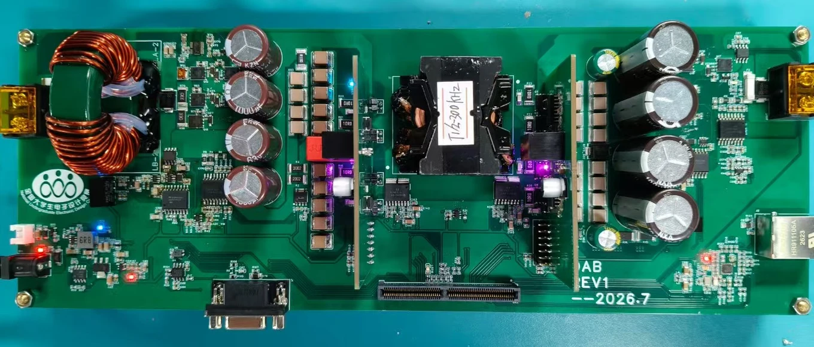
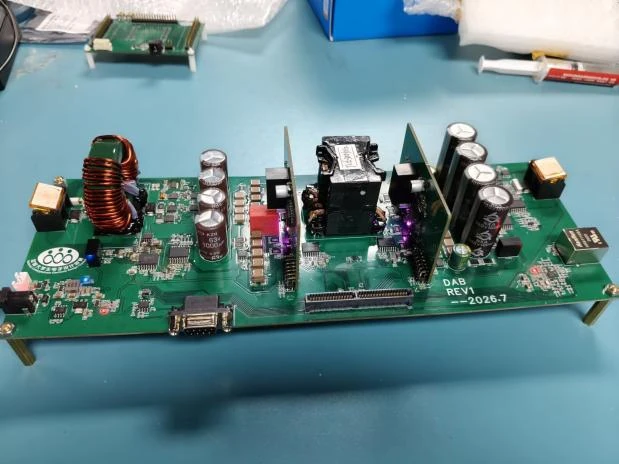
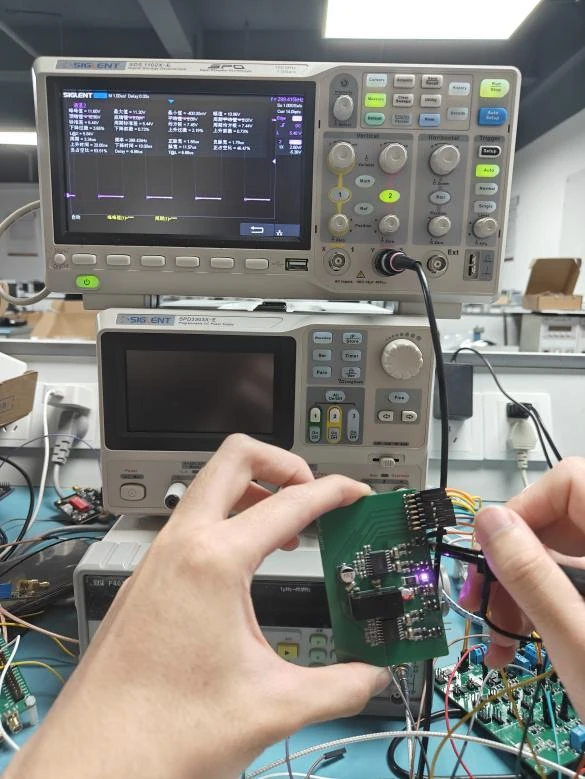

# 双向隔离 DAB DC-DC 电源

这是我们为光伏与储能直流母线做的双有源桥（DAB）变换器。主功率板和栅极驱动板分开设计，两侧全桥通过 1:2 高频变压器隔离，由瑞萨 RA8P1 控制。我负责这两块板的器件选型、原理图和四层 PCB 布局布线。

**[下载嘉立创 EDA 专业版工程](hardware/eda/DAB.epro2?raw=true)** · [浏览硬件文件](hardware/) · [查看固件与上位机](software/) · [下载完整仓库](https://github.com/ryule5158/DAB_DCDC/archive/refs/heads/main.zip)

## 硬件设计

- **双有源桥。** 原、副边各用一组 MOSFET 全桥，共 8 颗 MOSFET。竞赛样机的典型升压场景为 18–24 V 输入、36–48 V 母线。输入端有共模滤波、TVS 和预充电路。
- **隔离栅极驱动。** 驱动子板采用 UCC21520，配有隔离偏置、自举供电、独立的开通与关断电阻，以及栅源钳位。功率板上的故障信号可直接禁用驱动。
- **采样与保护。** TMCS1133 采集两侧高频电流，ACS725 采集输入和输出直流电流，AMC3330 用于母线电压隔离采样。TPS48111/TPS48110 驱动背靠背 MOSFET，配合预充和故障锁存电路。CAN 接口使用 TCAN3413。
- **四层 PCB。** 主板按功率、驱动、采样和控制分区。我把高频母线去耦靠近桥臂，缩短换流与栅极回路，并在原副边的隔离边界留出禁铜区。

## 样机与测试

样机装配后做了限流上电、栅极驱动输出和电阻负载测试。报告记录的栅极驱动波形为 **299.42 kHz、11.60 Vpp**。五个带载工况记录的最高**电源侧输入功率**为 **237.8 W**。波形、测试条件和各工况读数见[竞赛报告第 3.5 节](docs/competition/project-report.pdf)。

## 工程文件

| 内容 | 从这里打开 |
| --- | --- |
| 原理图与 PCB | [DAB.epro2](hardware/eda/DAB.epro2)，下载后导入嘉立创 EDA 专业版 |
| BOM 和设计记录 | [H1.7 设计归档](hardware/H1.7/)，含 BOM、逐引脚连接表、四层板布局说明和 Simulink 模型 |
| RA8P1 双核固件 | [双核工程说明](software/RA8P1_DAB_Feature_Showcase/dual_core/) |
| 串口上位机 | [Python 项目及运行说明](software/RA8P1_DAB_UpperComputer/) |
| 仿真、实测与调试记录 | [验证资料](docs/validation/)和[台架工具](tools/) |
