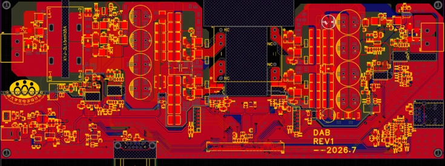

# 1 kW 级双向隔离 DAB DC-DC 电源

这是面向储能电池充放电和低压直流母线的 1 kW 级双有源桥（DAB）硬件设计。瑞萨 RA8P1 控制两侧全桥，通过 1:2 高频变压器隔离并实现双向功率变换。我负责主功率板和栅极驱动板的器件选型、原理图及四层 PCB 布局布线。

**[下载嘉立创 EDA 专业版工程](hardware/eda/DAB.epro2?raw=true)** · [浏览硬件文件](hardware/) · [查看固件与上位机](software/) · [下载完整仓库](https://github.com/ryule5158/DAB_DCDC/archive/refs/heads/main.zip)

## 硬件设计

- **双有源桥。** 原、副边各用一组 MOSFET 全桥，共 8 颗 MOSFET。输入端有共模滤波、TVS 和预充电路。
- **隔离栅极驱动。** 驱动子板采用 UCC21520，配有隔离偏置、自举供电、独立的开通与关断电阻，以及栅源钳位。功率板上的故障信号可直接禁用驱动。
- **采样与保护。** TMCS1133 采集两侧高频电流，ACS725 采集输入和输出直流电流，AMC3330 用于母线电压隔离采样。TPS48111/TPS48110 驱动背靠背 MOSFET，配合预充和故障锁存电路。CAN 接口使用 TCAN3413。
- **四层 PCB。** 主板按功率、驱动、采样和控制分区。我把高频母线去耦靠近桥臂，缩短换流与栅极回路，并在原副边的隔离边界留出禁铜区。

## 主功率板与栅极驱动板

## 工程文件

| 内容 | 从这里打开 |
| --- | --- |
| 原理图与 PCB | [DAB.epro2](hardware/eda/DAB.epro2)，下载后导入嘉立创 EDA 专业版 |
| BOM 和设计参考 | [硬件资料索引](hardware/)，含首板 BOM、逐引脚接线表和四层板布局说明 |
| RA8P1 双核固件 | [双核工程说明](software/RA8P1_DAB_Feature_Showcase/dual_core/) |
| 串口上位机 | [Python 项目及运行说明](software/RA8P1_DAB_UpperComputer/) |
